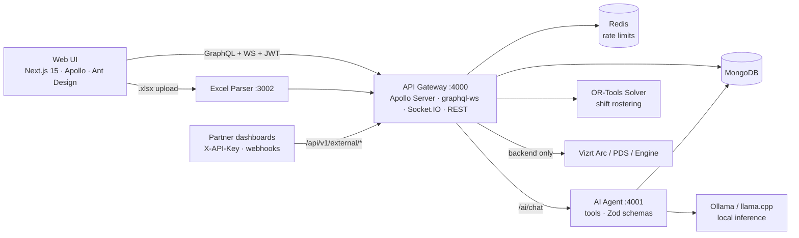

<div align="center">


### Open-source ERP for broadcast operations

**Planning · MCR · Shifts · Warehouse · Graphics · Rights · an on-prem AI copilot — in one platform.**

[](LICENSE)
[](https://github.com/RoadToMythicGlory/lancelot-ai/actions/workflows/ci.yml)
[](package.json)
[](#tech-stack)
[](apps/web)
[](services/api-gateway)
[](docker-compose.yml)
[](#quick-start)
[](CONTRIBUTING.md)

[Quick start](#quick-start) · [Features](#what-it-does) · [Architecture](#architecture) · [Docs](docs/) · [User manual (עברית)](docs/user-manual/00-index.md) · [Contributing](CONTRIBUTING.md)

</div>

---

## Why Lancelot

Running a TV channel is a scheduling problem wearing twenty different hats: which feed lands on which IRD at 02:00, who is on the control-room shift, which camera kit is in which van, which rights contract covers tonight's match, and whether the graphics template is loaded before the anchor says "and now…". Most stations stitch this together from Excel sheets, WhatsApp groups and memory.

Lancelot replaces that with a single, real-time, role-aware system that was built **inside a live sports broadcaster** over several seasons — then released as open source so no station has to pay six figures for the same thing again.

- **Built by operators, for operators.** Every screen started as a real control-room pain point.
- **Offline-first AI.** The assistant runs on a local LLM (Ollama / llama.cpp). No data leaves your building.
- **Hebrew-native, RTL-ready, fully localisable.** Ships with a complete Hebrew user manual and i18n throughout.
- **Self-hostable in an afternoon.** One `docker compose up`, one MongoDB, done.

## What it does

| Module | Highlights |
|---|---|
| **Broadcast Planning** | Weekly grid, Excel import with conflict detection, parallel-channel & 4K flags, venues, bulletins, per-department data, live GraphQL subscriptions |
| **MCR / Flight Board** | TV-ready kiosk view of every incoming feed, satellite/IRD routing, per-panel toggles, edit vs. view boards, rundown printing |
| **External Broadcasts** | Field productions, OB vans, crews and contacts; shared-engineering-equipment view exposed to partners via a REST + webhook [external API](docs/external-api/README.md) |
| **Shifts** | Templates, availability constraints, swap & vacation requests, unavailable-user warnings, OR-Tools solver for automatic rostering |
| **Warehouse** | Equipment lifecycle, sets, internal/external assignments, BLE tracking ingest, PDF/Excel import, volume & storage-place capacity alerts, canonical categories |
| **Graphics (Vizrt)** | Template & configuration management and operator CG control panel — backend-mediated, never direct from the browser ([guide](docs/VIZRT_INTEGRATION_GUIDE.md)) |
| **Rights & Media** | Rights board for licensed competitions, DAM for media assets |
| **Users & RBAC** | Departments, role templates, centralised permission matrix, full audit log |
| **Chat** | Private conversations over Socket.IO with optional end-to-end encryption; the AI agent is a first-class chat participant |
| **AI Copilot** | Local LLM with tools: schedule lookup, shift lookup/solve, equipment availability, news brief, lineup builder, CG spec generator, rights board, in-app help search. Structured outputs validated with Zod |
| **Ops** | Prometheus + Grafana, rate limiting (Redis-backed), JWT rotation, CSRF, CORS allowlist, Telegram-alerting watchdog |

## Quick start

**Prerequisites:** Docker + Docker Compose. For the AI copilot, [Ollama](https://ollama.com) on the host (optional).

```bash
git clone https://github.com/RoadToMythicGlory/lancelot-ai.git
cd lancelot-ai

# 1. Configure credentials (the only place they live)
cp .env.example .env
#    set MONGO_PASSWORD and JWT_SECRET  →  openssl rand -base64 64

# 2. Bring the stack up (MongoDB, API, web, Excel parser, AI agent, solver, Redis, Prometheus, Grafana)
docker compose up -d --build

# 3. Create the first system admin
docker compose exec -e ADMIN_EMAIL=you@yourstation.tv -e ADMIN_PASSWORD='a-strong-password' \
  api-gateway node dist/scripts/bootstrap-system-admin.js
```

Then sign in at http://localhost:3000. To enable the AI copilot, run `ollama pull aya-expanse:8b` on the host.

| Service | URL |
|---|---|
| Web UI | http://localhost:3000 |
| GraphQL API & playground | http://localhost:4000/graphql |
| AI agent | http://localhost:4001/health |
| Excel parser | http://localhost:3002 |
| Grafana | http://localhost:3001 |

<details>
<summary><b>Local development without Docker</b></summary>

```bash
npm run install:all          # root + web + api-gateway
# MongoDB on localhost:27017 (or point MONGO_* at yours)
npm run dev                  # web :3000 + api :4000 with hot reload
# optional, in separate terminals:
cd services/excel-parser && npm run dev
cd services/ai-agent     && npm run dev
```

Windows: `npm run dev:windows`.
</details>

<details>
<summary><b>Seeding demo data</b></summary>

```bash
cd services/api-gateway
npm run seed:help             # in-app help center from docs/user-manual
npx ts-node src/scripts/seed-department-users.ts   # 22 departments, sample users
```

All seeded accounts use placeholder `@example.com` addresses and must be given real passwords before any non-local use.
</details>

## Architecture



**Design rules the codebase follows**

1. The backend owns business rules and every third-party integration; the browser is presentation and orchestration only.
2. No cloud LLM dependency — the AI agent is an internal user with its own crypto keys, talking to a model on your hardware.
3. Deterministic, explainable scheduling: conflicts and solver decisions are always surfaced, never silently resolved.
4. Everything that changes state is audited.

Deeper dives: [data flow](docs/DATA_FLOW.md) · [developer summary](docs/PROJECT_SUMMARY_DEVELOPERS.md) · [one-pager](docs/root-guides/ONE_PAGER.html) · [all docs](docs/).

## Repository layout

```
apps/web/                 Next.js application (all UI modules)
services/api-gateway/     GraphQL + REST + Socket.IO backend, auth, RBAC, resolvers, seeds
services/ai-agent/        Local-LLM agent: orchestrator, tools, RSS/news, rights board
services/excel-parser/    Schedule spreadsheet → normalised JSON
services/or-tools-solver/ Python OR-Tools service for shift rostering
services/shared/          Shared crypto helpers (E2EE)
docs/                     Guides, data flow, deployment, Hebrew user manual, external API
config/ k8s/ mosquitto/   Prometheus/Grafana, Kubernetes manifests, MQTT broker for BLE tracking
scripts/                  Dev/ops helpers (watchdog, Telegram alerts, deployment packaging)
```

## Tech stack

**Frontend** Next.js 15 · React 18 · TypeScript · Apollo Client · graphql-ws · Ant Design · Tailwind
**Backend** Node 18+ · Express · Apollo Server 4 · Socket.IO · MongoDB 6 driver · Zod · bcrypt · JWT
**AI** Ollama (default) or llama.cpp · tool-calling orchestrator · structured outputs
**Infra** Docker Compose · Turborepo · Redis · Prometheus · Grafana · Mosquitto (MQTT) · Kubernetes manifests · GitHub Actions

## Deployment

Production guides live in [`docs/root-guides/`](docs/root-guides/): [AlmaLinux VPS](docs/root-guides/ALMALINUX_VPS_DEPLOYMENT_GUIDE.md) · [cPanel/Passenger](docs/root-guides/CPANEL_DEPLOYMENT_GUIDE.md) · [Docker secrets](docs/DOCKER_SECRETS_GUIDE.md) · [`Dockerfile.production`](Dockerfile.production) · [`k8s/`](k8s/) · [`nginx-example.conf`](nginx-example.conf). A hardening-oriented watchdog with Telegram alerts is in [`scripts/ops/`](scripts/ops/).

## Contributing

Issues and pull requests are very welcome — see [CONTRIBUTING.md](CONTRIBUTING.md) for the dev loop, commit conventions and what makes a PR easy to merge. Security issues: please read [SECURITY.md](SECURITY.md) instead of opening a public issue.

## License

[GNU AGPL v3](LICENSE). You can run, study, modify and redistribute Lancelot freely, including commercially — if you offer a modified version as a hosted service, you must publish your changes under the same license. Need a different arrangement? Open an issue.

---

<div align="center">
Built in a control room, released to the world. ⚔️
</div>
