# Lancelot Platform — End-to-End Data Flow

> **Last updated:** February 9, 2026

---

## Full System Data Flow

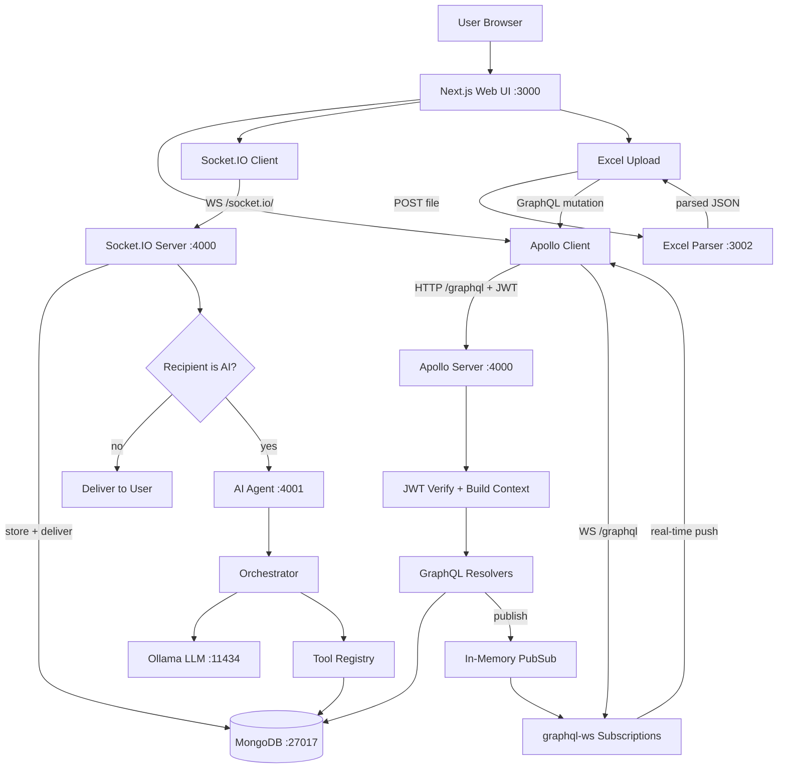

---

## Authentication Flow

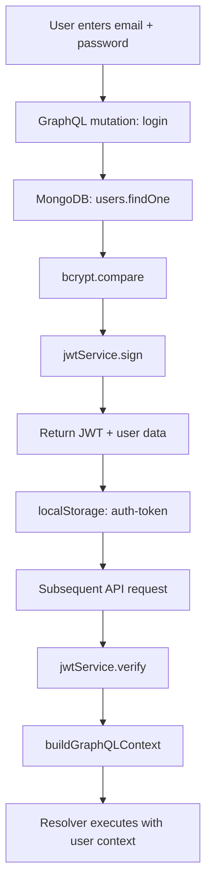

---

## GraphQL Request Flow

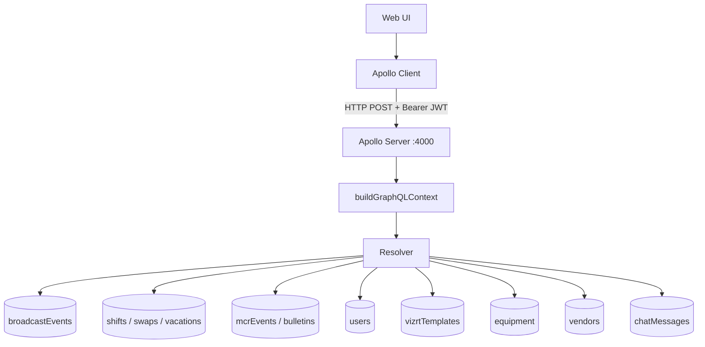

---

## GraphQL Subscriptions Flow

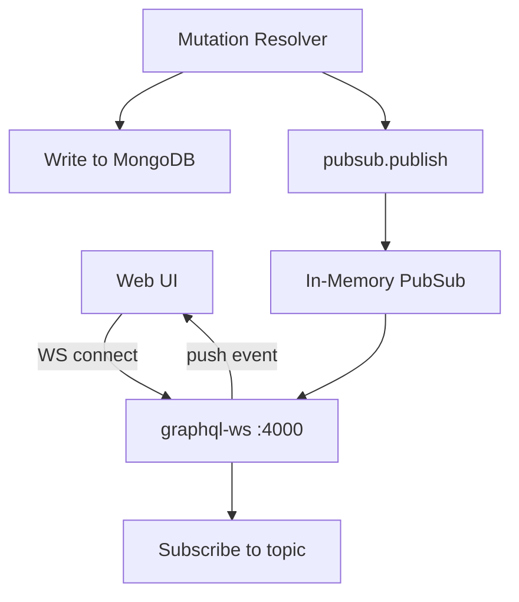

---

## Socket.IO Chat Flow

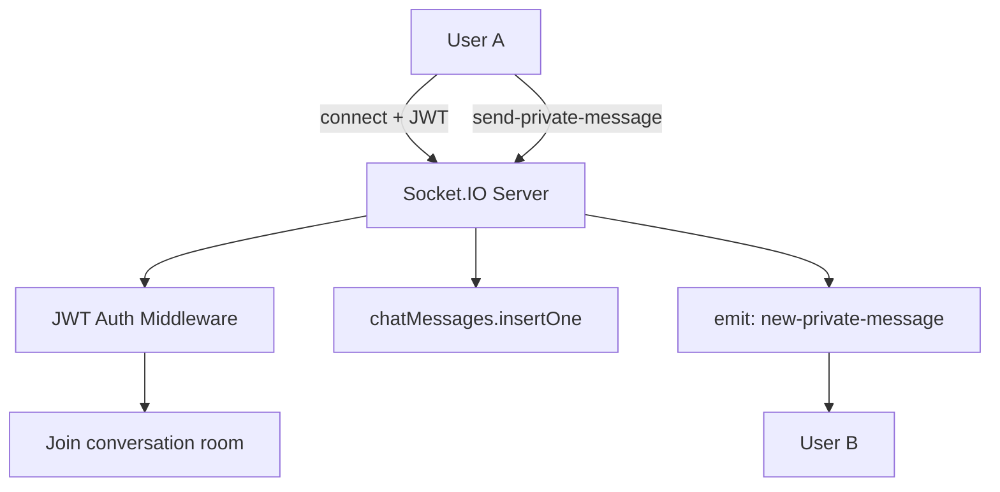

---

## AI Agent Chat Flow

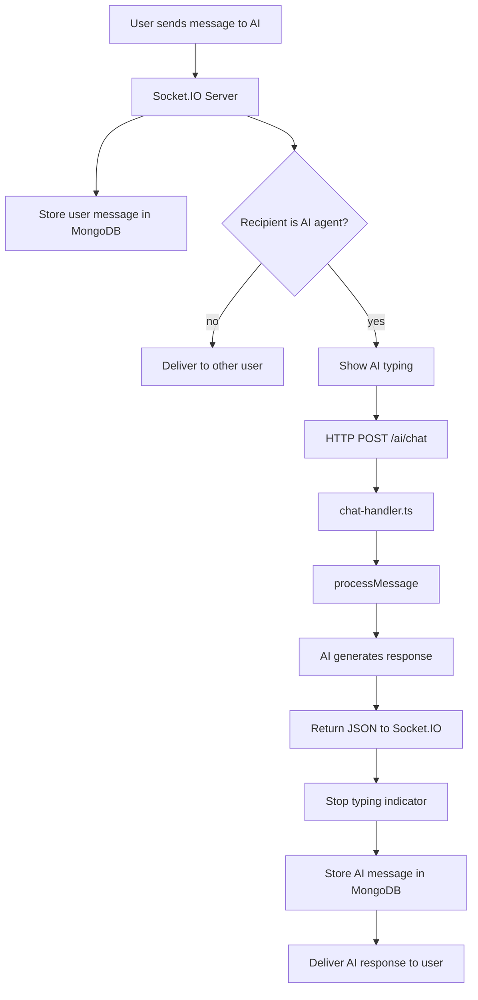

---

## AI Agent Internal Pipeline

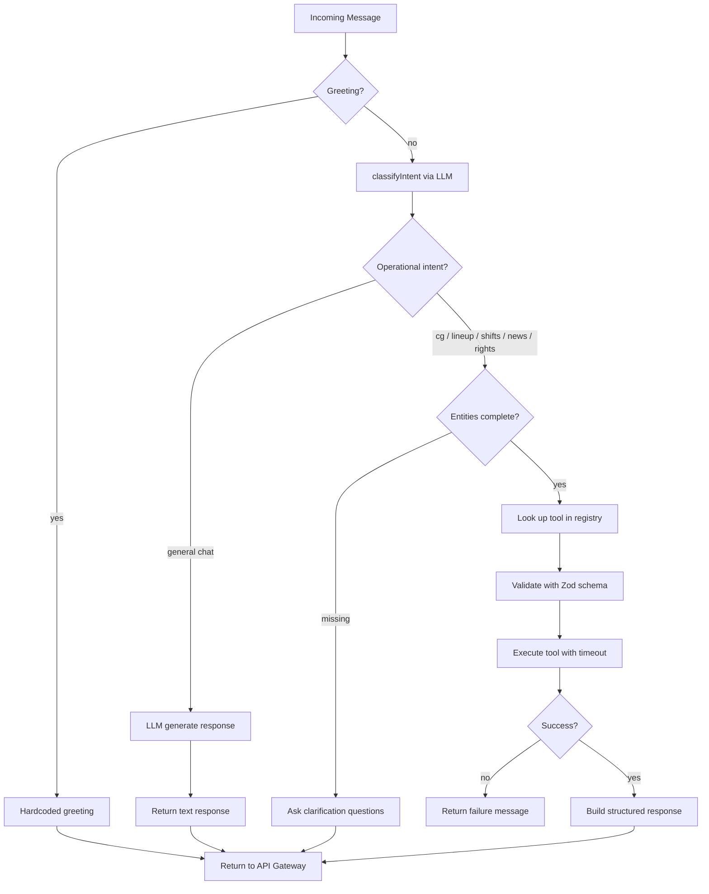

---

## AI Tool: News Fetcher

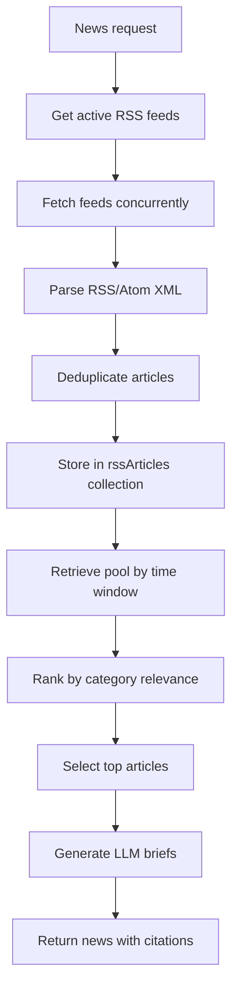

---

## AI Tool: Lineup Builder

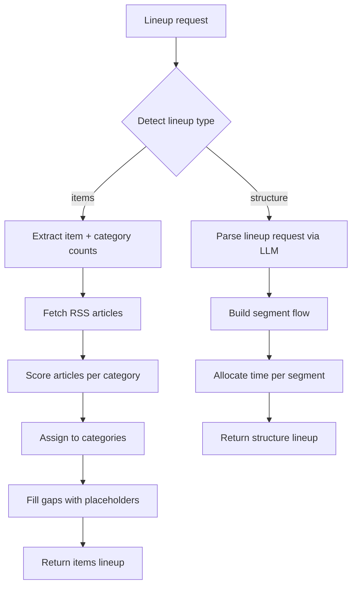

---

## AI Tool: CG Spec Generator

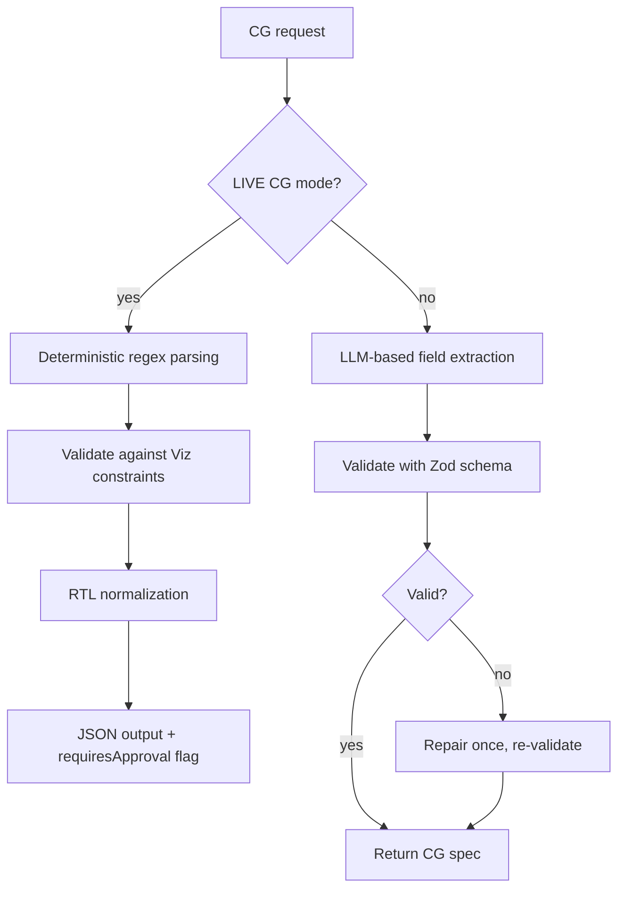

---

## AI Tool: Shift Scheduler

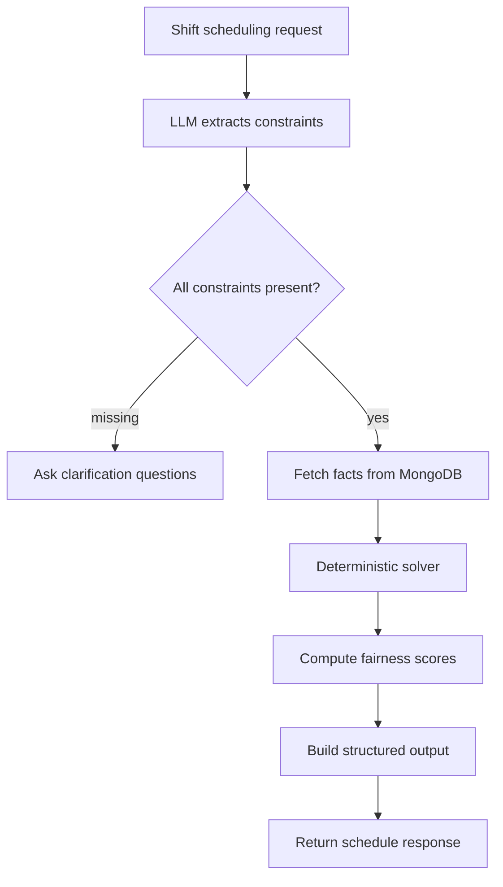

---

## Excel Import Flow

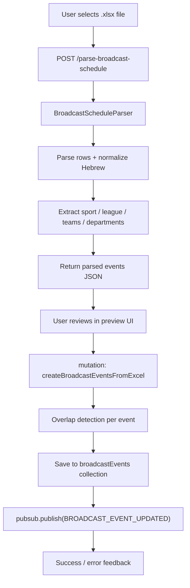

---

## Data Stores

### MongoDB Collections

| Collection | Owner | Purpose |
|------------|-------|---------|
| `users` | API Gateway | User accounts, auth, departments, AI agent user |
| `broadcastEvents` | API Gateway | Broadcast event records |
| `privateConversations` | API Gateway | Chat conversation metadata |
| `chatMessages` | API Gateway | Chat message history |
| `shifts` | API Gateway | Shift assignments |
| `shift_templates` | API Gateway | Shift template definitions |
| `shift_swap_requests` | API Gateway | Shift swap requests |
| `vacation_requests` | API Gateway | Vacation requests |
| `availability_constraints` | API Gateway | Employee availability constraints |
| `employee_settings` | API Gateway | Per-employee settings |
| `specialDays` | API Gateway | Special day definitions |
| `mcrEvents` | API Gateway | MCR event records |
| `bulletinPosts` | API Gateway | MCR bulletin posts |
| `activityRows` | API Gateway | MCR activity rows |
| `equipment` | API Gateway | Warehouse equipment items |
| `equipment_assignments` | API Gateway | Equipment assignment records |
| `equipment_history` | API Gateway | Equipment transaction history |
| `vendors` | API Gateway | Vendor records |
| `vizrtTemplates` | API Gateway | Vizrt graphics templates |
| `vizrtConfigurations` | API Gateway | Vizrt system configurations |
| `aiConversationMemory` | API Gateway | AI conversation memory |
| `rssArticles` | AI Agent | Cached RSS articles (TTL-indexed) |
| `newsCache` | AI Agent | News query cache |
| `trustedSources` | AI Agent | Trusted RSS source definitions |
| `broadcastRights` | AI Agent | Broadcast rights data |
| `sportsFixtures` | AI Agent | Sports fixture data |
| `leagueStandings` | AI Agent | League standings data |

---

## Key Files

| Area | File |
|------|------|
| Frontend providers | `apps/web/src/app/client-providers.tsx` |
| Apollo Client | `apps/web/src/lib/apollo-client.ts` |
| Socket.IO Client | `apps/web/src/contexts/WebSocketContext.tsx` |
| Gateway entry | `services/api-gateway/src/index.ts` |
| MongoDB config | `services/api-gateway/src/config/mongodb.ts` |
| GraphQL schema | `services/api-gateway/src/schema/schema.graphql` |
| Chat socket | `services/api-gateway/src/socket/chat-socket.ts` |
| Auth resolver | `services/api-gateway/src/resolvers/auth.ts` |
| Context builder | `services/api-gateway/src/middleware/context.ts` |
| PubSub | `services/api-gateway/src/utils/pubsub.ts` |
| AI resolvers | `services/api-gateway/src/resolvers/ai.ts` |
| Excel parser | `services/excel-parser/src/broadcast-schedule-parser.ts` |
| AI chat handler | `services/ai-agent/src/api/chat-handler.ts` |
| AI orchestrator | `services/ai-agent/src/agent/orchestrator.ts` |
| Intent classifier | `services/ai-agent/src/agent/intent-classifier.ts` |
| Tool registry | `services/ai-agent/src/tools/index.ts` |
| RSS pipeline | `services/ai-agent/src/rss/` |
| AI data layer | `services/ai-agent/src/data/index.ts` |
